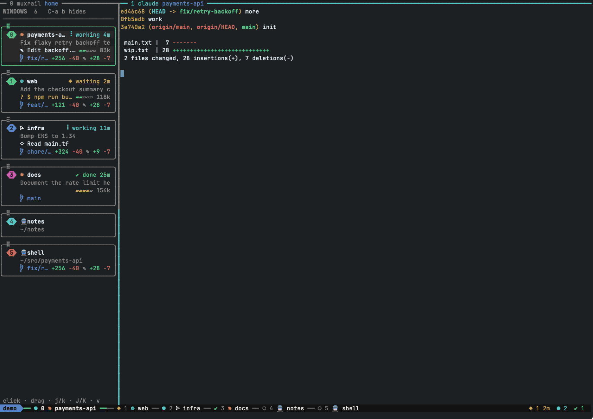
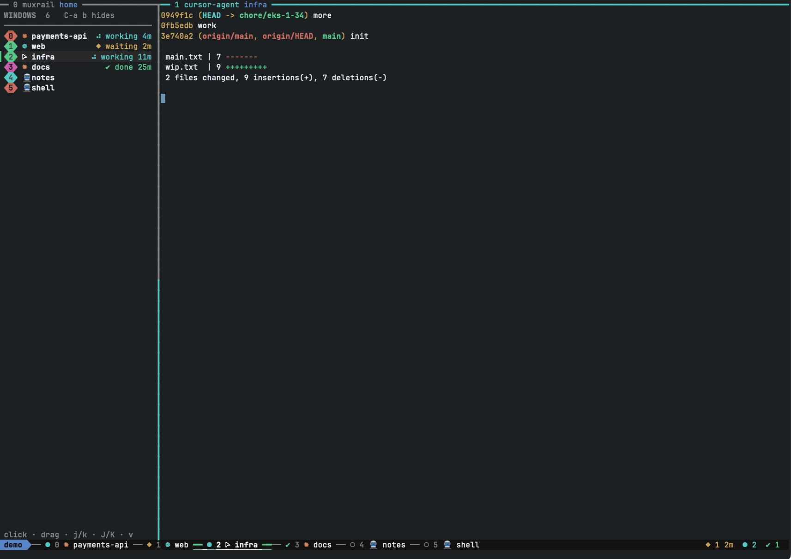

# muxrail

A rail of every tmux window, down the side and along the bottom, whether it runs a coding agent or a plain shell.
Windows that run Claude Code, Codex or Cursor also show what the agent is doing.



- **Sidebar.** One card per window, agent or plain shell, with its folder and git changes. An agent's card adds its logo, its
  state and how long it has been in it, and the task title. Click a card to switch, drag it (with a live preview) or press
  `J`/`K` to reorder.
- **Tab rail.** The tab bar drawn as stops on a rail, each coloured by its agent's state, with the agent counts at the right.
- **What the agent is doing.** A Claude Code, Codex or Cursor card shows the tool call in flight, a permission prompt in yellow,
  and a gauge of how full the context is.
- **Session search.** One fuzzy-searchable list of every Claude Code, Codex and Cursor CLI session, with a preview, and a key that
  resumes the one you pick in a new window.

Status: working. macOS on Apple silicon is the tested platform. `cmd/` and `internal/` implement [docs/spec.md](docs/spec.md).

## Why muxrail

I run coding agents next to plain shells in one tmux session: Claude Code on one repo, Codex on another, Cursor on a third,
and shells for logs, AWS and notes in between. The sidebars I tried list agents only, so the shells drop out and I am back to
reading the tab bar. muxrail lists every window and adds agent detail where an agent runs.

- **It watches, it does not launch.** My agents start from another tool, in their own worktrees. muxrail creates no sessions,
  worktrees or panes, so it never competes with whatever starts them.
- **Every agent I use, one view.** Claude Code, Codex and Cursor windows show the logo and the tool call in flight, with a
  context gauge where the transcript records tokens (Claude Code and Codex). One search finds and resumes a session from any
  of them.
- **The window order is mine.** Drag a card or press `J`/`K` and the window moves; the tab rail follows.
- **One look.** The sidebar and the tab rail draw with the terminal's 16 theme colours, so both follow its theme.
- **Status from its own hooks.** Agent state comes from `muxrail hook`, called from the agent's own hooks (the Claude Code
  block is under Agent states), not from another tool.

For an agent dashboard instead, see [tmux-agent-sidebar](https://github.com/hiroppy/tmux-agent-sidebar) (agent panes across
every session, with notifications, subagent trees and worktree spawn and teardown) or
[opensessions](https://github.com/Ataraxy-Labs/opensessions) (a session switcher with agent state and an HTTP API for scripts).

## Requirements

| What | Why |
|---|---|
| macOS on Apple silicon, tmux 3.8+ | the tested platform; the release archives also carry Intel and Linux builds, untested |
| A [Nerd Font](https://www.nerdfonts.com) 3.5+ **selected in the terminal** | the agent logos and the rounded index pills are Nerd Font glyphs; without one they show as empty boxes |
| [tpm](https://github.com/tmux-plugins/tpm) | loads the plugin that binds the keys and sets the hooks (or source `muxrail.tmux` yourself) |
| [fzf](https://github.com/junegunn/fzf) (tested with 0.70) | the session search popup |
| An ANSI-16 terminal theme | muxrail draws with the 16 theme colours, plus one orange for Claude, so it follows your palette |

Font: `brew install --cask font-jetbrains-mono-nerd-font`, then choose it in the terminal (Warp: Settings > Appearance > Text >
Font > `JetBrainsMono Nerd Font Mono`). A window that runs no agent shows a train emoji, which needs no font.

## Install

```bash
brew install kislow/tap/muxrail          # builds from source, about six seconds
brew install tmux fzf
```

Then add the plugin to `~/.tmux.conf`, with the tab rail if you want it. The `@muxrail_tabs` line must come before tpm's `run`:

```tmux
set -g @plugin 'tmux-plugins/tpm'
set -g @plugin 'kislow/muxrail'
set -g @muxrail_tabs rail

run '~/.tmux/plugins/tpm/tpm'
```

Reload (`tmux source ~/.tmux.conf`) and press `<prefix> I` to let tpm fetch the plugin. Then open a window and press `<prefix> b`.

**Without Homebrew or tpm.** Each release has archives with the binary and `muxrail.tmux`. Put `muxrail` on the `PATH` that
tmux starts with (or set `MUXRAIL_BIN` to its path), unpack the rest anywhere and add `run-shell /path/to/muxrail.tmux` to `~/.tmux.conf`.
The plugin only binds the keys and hooks to the binary, so a plugin and a binary of different versions never disagree about what the
bindings call.

```bash
gh release download --repo kislow/muxrail --pattern 'muxrail_*_darwin_arm64.tar.gz'
```

### Agent states

The state chip, the colours of the rail and `muxrail status` come from hooks that call `muxrail hook`. Add this to
`~/.claude/settings.json` (merge it into an existing `hooks` object):

```json
{
  "hooks": {
    "SessionStart": [
      { "matcher": "startup|resume|clear|fork", "hooks": [{ "type": "command", "command": "muxrail hook start" }] }
    ],
    "UserPromptSubmit": [
      { "hooks": [{ "type": "command", "command": "muxrail hook working" }] }
    ],
    "PostToolUse": [
      { "hooks": [{ "type": "command", "command": "muxrail hook working" }] }
    ],
    "Notification": [
      { "matcher": "permission_prompt|elicitation_dialog", "hooks": [{ "type": "command", "command": "muxrail hook waiting" }] }
    ],
    "Stop": [
      { "hooks": [{ "type": "command", "command": "muxrail hook done" }] }
    ]
  }
}
```

`muxrail hook [--kind NAME] start|working|waiting|done` records the state of the pane named by `$TMUX_PANE` in
`$XDG_STATE_HOME/muxrail/agents/<socket>/<pane id>.json` (default `~/.local/state/muxrail/agents`), where `<socket>` is the name of the
tmux server's socket (`default`, or the `-L` name), because pane ids restart at `%0` on every server. `start` registers the agent with no
state, so it shows without a chip until its first prompt. `--kind` defaults to `claude`. The command ignores stdin, prints nothing and
always exits 0, so a broken hook never disturbs a session; outside tmux it does nothing. Files of panes that no longer exist are deleted,
only from the folder of the server the sidebar is reading.
Without hooks you still get the logos, window names, git changes, reordering and session search; the states stay empty.

### Check it

```bash
muxrail version                  # the binary, on the PATH tmux started with
tmux list-keys -T prefix h   # the plugin bound the search key
```

The binary and the plugin should be the same version: update both together (see Update and uninstall).

## Use

Keys are bound in tmux's prefix table, so they follow your prefix (`<prefix>` is `C-b` unless you changed it).

| Key | Does |
|---|---|
| `<prefix> b` | show or hide the sidebar in every window |
| `<prefix> h` | search sessions (popup) |
| `<prefix> <` / `>` | move the current window left or right (repeatable) |

**Sidebar.** Click a card to switch to its window. Drag a card by its grip to reorder; the cards slide aside as you go. With the sidebar
focused: `j`/`k` or the arrows move the cursor, `J`/`K` move the selected window down or up, `Enter` switches, `v` toggles a
one-line-per-window layout. Drag the sidebar's border to resize it; the width is shared by every window.



**Cards.** The state glyph is `●` working (a spinner while it runs), `◆` waiting for you, `✔` done, `○` unknown, with the time in that
state. A Claude Code, Codex or Cursor card adds a row with what the agent is doing right now (`✎ Edit rail.go`, `$ go test`,
`thinking`). A waiting agent that has a tool call it has not run yet shows it in yellow as `? ✎ Edit rail.go`: that is a permission
prompt. On the right of that row is a gauge of the context (`▰▰▰▱▱ 86k`), yellow past 60 percent and red past 85.

- Claude is matched to its window exactly, through `~/.claude/sessions`. A Claude transcript does not say which context window the
  session has, so the gauge measures against 200k, or 1M once a context outgrows that; `set -g @muxrail_ctx_window 1000000` fixes it.
- Codex reports its window, so its gauge is exact. Cursor records no token counts, so its card has the action and no gauge.
- Codex and Cursor do not record which pane they run in, so their card reads the newest transcript of the window's folder from the last
  12 hours. That is wrong only when two sessions of one agent share a folder.
- Other agents (Gemini, agy) show their logo and state but neither row yet. A process that looks like an agent but is not recognised
  gets a locomotive.

**Tab rail.** With `set -g @muxrail_tabs rail` each tab is a stop on a rail: a station coloured by the agent's state (`●` working,
`◆` waiting, `✔` done, `○` idle), the index, the logo and the name; the current window sits on a heavy green track. A window still
named like `2.1.318` shows a short conversation title instead. The plugin sets `window-status-format`,
`window-status-current-format` and an empty `window-status-separator`; formats you set after tpm's `run` line win. For the agent counts
at the right (`◆ 1 3m  ● 2  ✔ 3`, waiting first with the longest wait), add to `status-right`:

```tmux
set -g status-interval 5
set -ag status-right " #(muxrail status)"
```

Without `@muxrail_tabs` the tab bar is yours; the logo alone is one snippet:

```tmux
set -g window-status-format " #I #(muxrail tab #{window_id})#W "
set -g window-status-current-format " #I #(muxrail tab #{window_id} plain)#W "
```

**Session search (`<prefix> h`).** Type to fuzzy-search names, folders and what you typed in each session. Each row shows the agent, how
long ago it was active and the folder. `Tab` narrows to one agent, `ctrl-s` cycles the order (time, name, agent), `Enter` resumes the
session in a new window. The preview shows the exact date and the latest messages. Sessions whose folder no longer exists are left out,
and so are headless runs (`claude -p`, `codex exec`). Cursor IDE chats are not searched, only Cursor CLI sessions.

## Configuration

All options are tmux user options (`set -g ...`); the sidebar re-reads them every second.

| Option | Default | Does |
|---|---|---|
| `@muxrail_tabs` | unset | `rail` makes the plugin set the tab bar formats; read when the plugin loads |
| `@muxrail_ctx_window` | 200k, or 1M past it | context size the gauge measures against |
| `@sidebar_layout` | `tiles` | `tiles` (cards) or `compact` (one line per window); `v` toggles it |
| `@sidebar_width` | 34 | sidebar width in columns; dragging the border sets it |
| `@cap_l`, `@cap_r` | empty | end caps of the index pill, for example the Nerd Font glyphs `` and `` for rounded ends |
| `@sidebar_debug` | `0` | `1` logs raw input to `~/.tmux/sidebar-input.log` |

`MUXRAIL_BIN` (an environment variable, for example `tmux set-environment -g MUXRAIL_BIN /path/to/muxrail`) makes `muxrail.tmux` bind the keys and hooks to that binary
instead of the one on the `PATH`; the sidebar panes and the search popup run the binary by its absolute path. The tab and status
formats call `muxrail` by name.

## Commands

```text
muxrail sidebar                          run the sidebar UI in the current pane
muxrail sidebar toggle|ensure|wake|remember|apply <pane-id>
                                         build, size and wake the sidebars (what the keys and hooks call)
muxrail tab <window-id> [plain]          the tab-bar icon of a window
muxrail tab <window-id> rail|rail-current <index>
                                         a window's stop on the tab rail
muxrail status                           the agents by state, for the status bar
muxrail search --pick                    pick a session in fzf and resume it in a new window (<prefix> h)
muxrail search [--state FILE]            sessions as TSV for fzf
muxrail show <agent> <id> <cwd>          the latest messages of a session (the preview)
muxrail plan <agent> <id> <cwd>          the command that resumes a session
muxrail version                          print the version
```

## Privacy

muxrail runs entirely on your machine and makes no network calls. It reads the transcripts the agents already keep
(`~/.claude/projects`, `~/.claude/sessions`, `~/.claude/history.jsonl`, `~/.codex/sessions`, `~/.cursor/projects`), runs `git`, `ps`,
and `tmux`, and writes small caches and logs to `$TMPDIR` (`tmux-sidebar-agents.json`, the git cache,
`muxrail-sidebar-error.log`) and one small state file per agent pane to `~/.local/state/muxrail/agents/<socket>`. It never writes to an agent's files.

## Troubleshooting

- **Logos or pill ends show as empty boxes.** The terminal is not using a Nerd Font 3.5+. Select it in the terminal's settings; installing
  the font is not enough. Restart tmux (`tmux kill-server`) afterwards.
- **`<prefix> h` shows an error or nothing, or the rail tabs are blank.** The popup stays open on an error: `fzf` missing from the `PATH`
  shows up there. Otherwise the binary may be older than the plugin: run `muxrail version`, then `brew upgrade kislow/tap/muxrail`. The tab
  and status formats call `muxrail` by name, so it must be on the `PATH` the tmux server started with. A "binary not found" message when
  tmux loads the config means the same.
- **A sidebar looks stale right after switching windows.** A sidebar whose window is hidden refreshes every 10 seconds and does not animate, to
  keep one process per window cheap; a tmux hook wakes it when its window comes on screen. Update the plugin (`<prefix> U`) so the hook
  exists. A resize wakes it too.
- **No state chip, grey rail.** The hooks are missing from `~/.claude/settings.json` (see Agent states), or `muxrail` is not on the `PATH` Claude Code starts with. Test one with `TMUX_PANE=%1 muxrail hook working` inside tmux and look for `~/.local/state/muxrail/agents/<socket>/1.json`.
- **The sidebar is blank or exits.** Read `$TMPDIR/muxrail-sidebar-error.log`.
- **A session is missing from search.** Its folder was deleted, it was a headless run, or it is a Cursor IDE chat.
- **A Codex or Cursor card shows another session's action.** Two sessions of that agent share a folder; the card reads the newest one.

## Update and uninstall

```bash
brew update && brew upgrade kislow/tap/muxrail
# in tmux: <prefix> U     (updates the plugin to the same version)
```

To remove it: delete the `@plugin` and `@muxrail_tabs` lines, press `<prefix> alt-u` for tpm to remove the plugin, run
`brew uninstall muxrail`, and `tmux kill-server` once.

## Development

```bash
make build     # bin/muxrail, static, no cgo
make check     # vet, gofmt, unit tests
make e2e       # real tmux client with raw mouse events: e2e/drag_test.go, e2e/tabs_test.go, e2e/rail_test.go
```

Go 1.26+. The e2e tests start a private tmux server on their own socket, so they never touch yours.

**Releasing.** Versions come from Conventional Commits: PRs are squash-merged and the PR title is the commit (CI checks it).
`release-please` keeps one release PR open (version bump and `CHANGELOG.md`); merging it tags `vX.Y.Z` and creates the GitHub Release, and
`publish.yml` then runs the tests on the tag and attaches the darwin and linux binaries with goreleaser. The formula in
`kislow/homebrew-tap` builds from the release's source tarball, so the tap is pointed at a release by hand once the release exists:

```bash
TAP_DIR=/path/to/homebrew-tap make tap TAG=v0.6.0     # edits the formula, commits and pushes the tap
brew update && brew upgrade kislow/tap/muxrail
```

**Layout**

```text
cmd/muxrail/        entry point and subcommands
internal/...        tmux wrapper, agent detection, activity, git stats, session index, UI
scripts/            release helper (bump-tap.sh)
muxrail.tmux        tpm entry: binds the keys and hooks to the binary
e2e/                end-to-end Go tests (build tag `e2e`) through a real tmux client
docs/spec.md        behaviour spec and acceptance criteria
```

## License

Copyright 2026 [kislow](https://github.com/kislow). Licensed under [Apache-2.0](LICENSE).
